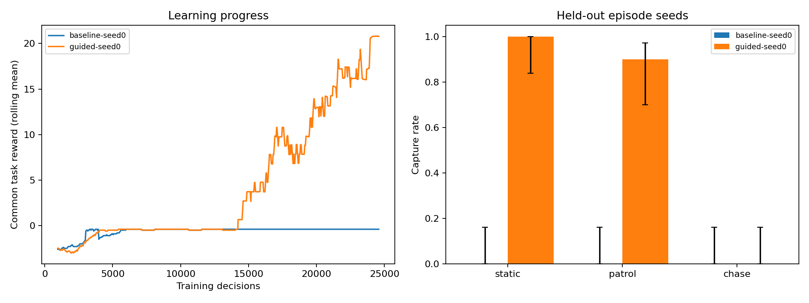
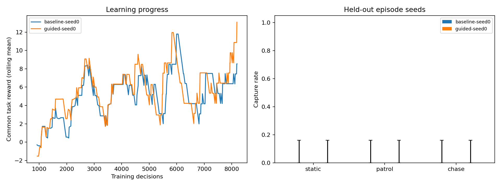

# Recorded results

Executed locally on Windows with Python 3.10.20, real PyQuaticus Heron dynamics, and CPU PPO. These are measured runs, not illustrative numbers.

## Main comparison

Both policies trained from scratch for 24,576 decisions against the static opponent, with training seed 0 and no initial-state curriculum. Each was evaluated deterministically on the same 20 held-out seeds (10000–10019) for each opponent. Evaluation always starts without a flag.

| Policy | Opponent | Captures / episodes | Mean capture time, successes only | Mean common reward | Mean tags received | Mean safety violation steps |
|---|---|---:|---:|---:|---:|---:|
| baseline | static | 0 / 20 | — | -0.40 | 0.00 | 0.00 |
| baseline | patrol | 0 / 20 | — | -2.90 | 1.15 | 0.00 |
| baseline | chase | 0 / 20 | — | -8.40 | 3.00 | 0.00 |
| guided | static | 20 / 20 | 88.8 s | 21.11 | 0.00 | 0.00 |
| guided | patrol | 18 / 20 | 140.3 s | 16.70 | 0.80 | 0.00 |
| guided | chase | 0 / 20 | — | -8.40 | 3.00 | 0.00 |



Raw results and uncertainty intervals: [baseline CSV](results/extended/baseline-seed0/evaluation.csv), [guided CSV](results/extended/guided-seed0/evaluation.csv), [baseline summary](results/extended/baseline-seed0/evaluation.summary.json), [guided summary](results/extended/guided-seed0/evaluation.summary.json). The default specification only requires staying in bounds and completing pickup then capture; receiving a tag is not itself an LTL violation for this specification.

### Training evidence

| Run | Completed training episodes | Training captures | Last 20 episodes: mean common reward |
|---|---:|---:|---:|
| baseline-seed0 | 512 | 1 | -0.40 |
| guided-seed0 | 573 | 176 | 20.79 |

The early 4,096-decision pilot produced no captures in deterministic evaluation for either policy (five episodes per opponent). Its logs remain in `results/pilot/`. The longer run tests whether additional learning overcomes that pickup-without-return behavior; no failed run has been removed.

## Initial-state curriculum experiment

Both policies trained from scratch for 8,192 decisions, seed 0, with 50% of training starts already carrying a flag in enemy territory. Evaluation still uses ordinary full-game starts and the same held-out seeds. This is a separate experiment with a different training distribution and budget; compare baseline versus guided within the table, not directly against the longer run above. The guided run consumes the actual live LLM translation artifact, whose formula matches the baseline's offline artifact exactly.

| Policy | Opponent | Captures / episodes | Mean capture time, successes only | Mean common reward | Mean tags received | Mean safety violation steps |
|---|---|---:|---:|---:|---:|---:|
| baseline | static | 0 / 20 | — | -2.40 | 0.00 | 0.00 |
| baseline | patrol | 0 / 20 | — | -2.40 | 0.00 | 0.00 |
| baseline | chase | 0 / 20 | — | -2.40 | 0.00 | 0.00 |
| guided | static | 0 / 20 | — | -2.40 | 0.00 | 0.00 |
| guided | patrol | 0 / 20 | — | -2.40 | 0.00 | 0.00 |
| guided | chase | 0 / 20 | — | -2.40 | 0.00 | 0.00 |



The fixed 50% return-start mixture did not transfer to full-game captures at this short budget. Both policies received return-leg practice but failed ordinary-start evaluation. This curriculum is an available experimental option, not a demonstrated improvement; an annealed mixture or longer matched training would need a new test.

## Live translation and verification

A real `gpt-4o-mini-2024-07-18` API call translated the example strategy to `G(in_bounds) & F(has_flag & F(captured))`, and passed syntax, fragment, vocabulary, and satisfiability checks on its first attempt. The [saved response](results/live-translation.json) contains the raw model output and validation witness, without credentials. That output was used by the guided curriculum experiment and a separate 512-decision resume-and-evaluate smoke run (`results/live-smoke/`). The smoke run verifies integration, not policy quality.

The independently bootstrapped project-local environment passed **26 tests**, recorded in [tests.xml](results/tests.xml). Coverage includes 1,032 short-trace comparisons against independent LTLf evaluation over a six-valuation test alphabet, unsupported/unsatisfiable formula rejection, translation repair, immutable safety failure, reset reproducibility, real pickup/capture and chasing tags, initialized carrying-state curriculum, potential telescoping, Gymnasium compatibility, and PPO train/save/reload/evaluate. Known upstream parallel-line geometry warnings are documented in the README.

## Interpretation and next experiments

This establishes an executable English-to-formal-logic-to-RL-to-game pipeline. It does not establish general superiority of neuro-symbolic RL: there is one training seed, narrow initial-position variation, one map, privileged state observations, shared waypoint primitives, and hand-coded defensive opponents. The guided method changes both rewards and monitor-state observations, so this is a package comparison rather than a reward-only causal ablation. Episode-level Wilson intervals do not measure training-seed uncertainty. Curves show learning progress, not proven convergence.

Practical follow-ups are multiple independent training seeds; equally budgeted patrol/chase curricula; separate distance-potential, milestone, penalty, and monitor-observation ablations; random-map and initial-state evaluation; and a true predictive shield if hard action constraints are needed. The `cautious.txt` strategy adds `G(!tagged)` for a distinct safety objective. A reward penalty does not enforce that rule with certainty. Infinite-horizon specifications and MARL require extending the compiler and environment facade as described in the README.

## Extension runs

The extension harness completed two additional guided chase seeds with 4,096 decisions and five held-out episodes per opponent: [matrix.json](results/chase-seeds/matrix.json). Both seeds scored 0/5 against static, patrol, and chase at this deliberately short budget. This is useful variance evidence, not evidence that the longer 24,576-decision guided policy fails; the main seed-0 run reached 20/20 static and 18/20 patrol captures after substantially more training.

The new 2v2 shielded PPO path also completed a smoke train/evaluate run: [team policy](results/team-smoke/policy.zip), [team summary](results/team-smoke/evaluation.summary.json). It exercised all nine combinations of standard/wide/narrow arenas and static/patrol/chase opponents. The 512-decision smoke policy captured 0/1 in every cell, as expected for an integration check. The important result is that joint stepping, team metrics, shield bookkeeping, terminal reset, and all three arena geometries execute end to end.

## Reproduce

From the project directory after bootstrap:

```powershell
mctf experiment --output runs/extended --steps 24576 --seeds 0 --episodes 20
mctf experiment --output runs/curriculum --steps 8192 --seeds 0 --episodes 20 --return-start-probability 0.5
```

The offline compiler produces exactly the same validated capture formula as the recorded live model response, so the formal input to these reproductions is identical. To use the saved live artifact explicitly, pass `--spec results/live-translation.json` to `mctf train` with the corresponding options. Further live model calls need the user's endpoint/model and `LTL_API_KEY`.
